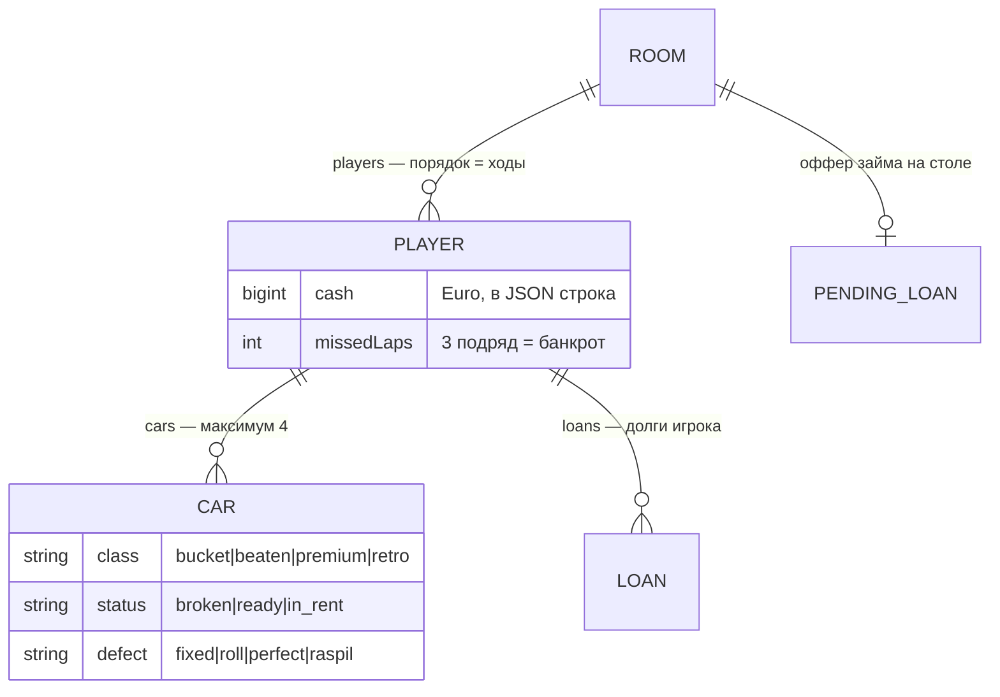
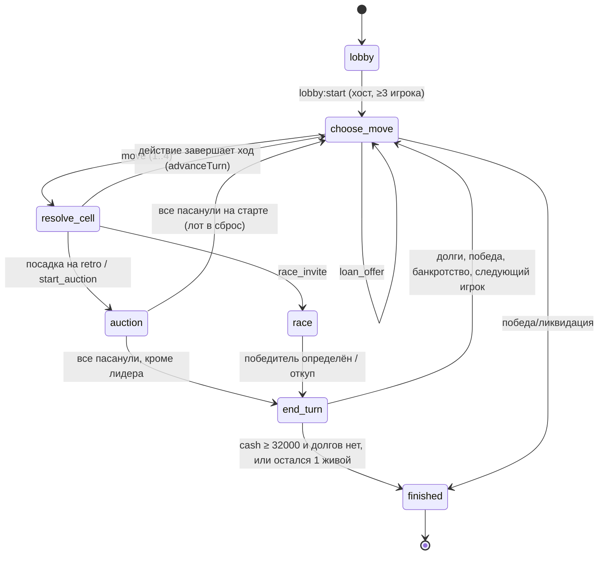

# DATA-MODEL — состояние комнаты и хранение

## SQLite: единственная таблица `rooms` (`server/snapshot.ts:4-9`)

| Колонка | Тип | Содержимое |
|---|---|---|
| `id` | TEXT PK | id комнаты (в dev — из URL `?room=…`, `client/src/App.tsx:232`) |
| `state` | TEXT | полный JSON `Room`; bigint-деньги обёрнуты в `{"$euro": "1600"}` (`server/snapshot.ts:18-24`) |
| `updated_at` | INTEGER | `room.updatedAt` (мс) |

Запись — upsert в `saveRoom` (`server/snapshot.ts:30-35`), вызывается из
`updateRoom` **только при смене хода или финише** (`server/room.ts:394-403`) —
не на каждый клик. Чтение — `loadRooms` (`server/snapshot.ts:42-43`) при старте
сервера: `loadPersistedRooms` восстанавливает комнаты и перезапускает таймеры
(`server/room.ts:45-66`, вызов `server/index.ts:50`; подключено в T1-core,
FINDINGS-5).

## Логические сущности внутри JSON комнаты

## Форма `Room` (`server/types.ts:88-98`)

- `id: string` — id комнаты.
- `players: Player[]` — порядок в массиве = порядок ходов (`server/types.ts:90`).
  `Player` (`server/types.ts:38-48`): `id` (Telegram id из initData), `name`,
  `cash: Euro`, `position` (0..8), `cars: Car[]` (макс 4), `loans: Loan[]`,
  `missedLaps`, `bankrupt`, `turnCount`.
- `turn: number` — индекс активного игрока в `players`.
- `phase: Phase` — см. диаграмму ниже (`server/types.ts:70-77`).
- `decks` / `discards: Record<CarClass, Car[]>` — по классу: bucket, beaten, premium,
  retro (`server/types.ts:4`). Каждая карта несёт свой `defect`; при переработке сброса
  статус сбрасывается в `broken` (или `ready` для perfect), `rentSteps: 0`
  (`server/decks.ts:154-166`).
- `pendingLoan?: PendingLoan | null` — оффер P2P-займа (`server/types.ts:79-86`).
- `timerExpiresAt?: number` — мс; выставляется `scheduleTurnTimer` (`server/room.ts:416-427`),
  попадает в `room:state`, клиент показывает обратный отсчёт со скью по `updatedAt`
  (`client/src/components/auction/AuctionModal.tsx:17-35`).
- `updatedAt: number` — штамп изменений.

`Car` (`server/types.ts:13-24`): `class`, `purchase`, `buyout`, `taxiMult` (0 у retro),
`status: broken|ready|in_rent`, `rentSteps?`, `defect: Defect`. `Defect` — union из
четырёх видов: `fixed`, `roll` (d6 × multiplier), `perfect`, `raspil`
(`server/types.ts:7-11`).

## Фазовая машина хода

Важно: `end_turn` — **транзиентная фаза**: её выставляют `concludeAuction`
(`server/auction.ts:119,139`) и `forfeitRace` (`server/race.ts:106`), но в том же
вызове `handleIntent` сразу зовётся `advanceTurn`, который переводит комнату в
`choose_move` (`server/turn.ts:137-146`) или `finished`. Клиент застать `end_turn`
не успевает.

Аукцион и гонка — вложенные состояния фазы (`phase.name === 'auction' | 'race'` с
полем `state`), не отдельные комнаты. Статусы гонки: `invitation → pool_entry →
rolling` с тайбрейк-перебросками (`server/race.ts:152-210`, таймеры в
`server/room.ts:421-447`).

## Что НЕ персистится

| Сущность | Где живёт | Почему |
|---|---|---|
| Лобби (`this.lobbies`) | только RAM, `server/room.ts:30` | до старта матча сохранять нечего; рестарт сервера = лобби собирается заново |
| `timerExpiresAt`-таймер (`NodeJS.Timeout`) | `active.timer`, RAM (`server/room.ts:20`) | таймер пересоздаётся при следующем событии; в JSON уходит только метка времени |
| `disconnectTimers`, `activeSockets` | RAM (`server/room.ts:21-22`) | привязаны к живым сокетам |
| Мид-ходовые изменения (ставки аукциона, входы в пул, ремонты) | в RAM до конца хода | снимок пишется только на границе хода (`server/room.ts:394-403`); падение сервера посреди хода откатывает комнату к последней границе |

Противоречие с `RULES.md:270-271`: сохранение фактически — по смене `turn`
(`server/room.ts:394-403`), не по `end_turn/auction_end/race_end` (FINDINGS-15);
восстановление после рестарта с T1-core работает (`server/room.ts:45-66`),
WAL и busy_timeout включены в `openDb` (`server/snapshot.ts:13-15`).

## Сериализация в сеть

`serializeRoom` (`server/snapshot.ts:37-40`) превращает все bigint в строки —
поэтому клиентский контракт (`client/src/api/types.ts:1-2`) требует `string` для денег.
Обратное преобразование на клиент не возвращается: клиент не считает деньги.
