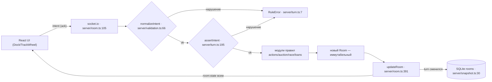

# MAP — карта модулей «Тачка»

Покрыты все файлы `server/` (26) и `client/src/` (24); тест-файлы — по одной строке.
Строка входа — где живёт основная точка входа модуля. Проект без сборщика на сервере:
`node --experimental-strip-types server/index.ts` (`package.json:9`).

## Сервер

| Файл | Что делает | Ключевые экспорты | Вход |
|---|---|---|---|
| `index.ts` | env и периметр в объект `perimeter`, HTTP-сервер, Socket.IO, вызов `loadPersistedRooms`, TTL-интервал | `perimeter` | 22 |
| `http.ts` | HTTP-периметр: /health, /dev/token (в prod — 404 без `DEV_TOKEN=1`), CORS-политика (`ALLOWED_ORIGINS`, в dev localhost), статика: ассет с расширением не найден → 404, SPA-fallback только для роутов | `createHttpHandler`, `corsAllowsOrigin`, `parseAllowedOrigins`, `makeDevInitData` | 61 |
| `validation.ts` | граница сокета: `parseEuro` (number/string/bigint → неотрицательный bigint) и `normalizeIntent` — whitelist 17 типов, деньги → bigint, id ≤ 64 символов, лишние поля отбрасываются | `parseEuro`, `normalizeIntent` | 26 |
| `room.ts` | RoomManager: auth/intent/lobby:start/disconnect, нормализация интента, роутинг, таймеры, дисконнект-грейс, восстановление комнат из SQLite | `RoomManager`, `LobbyUser`, `ActiveRoomState` | 26 |
| `types.ts` | типы домена: Car, Player, Room, Phase, Intent (17), лимиты | `Intent`, `Room`, `GARAGE_CAP`, `MIN_PLAYERS` | 100 |
| `turn.ts` | RuleError, перемещение, смена хода, победа, автоход (таксует найденной не-retro машиной), гейт интентов | `RuleError`, `applyMove`, `advanceTurn`, `assertIntent`, `checkWin` | 7 |
| `actions.ts` | правила действий клетки: ремонт, чермет, скупка, прокат, такси, покупка | `applyRepair`, `applyScrap`, `applyBuyout`, `applyRent`, `applyTaxi`, `applyBuy` | 43 |
| `auction.ts` | открытый аукцион: старт, ставка +100/+500, пас, завершение | `startAuction`, `applyBid`, `applyAuctionPass`, `concludeAuction` | 15 |
| `race.ts` | дуэль-гонка: вызов, принятие, откуп, пул, броски, тайбрейк | `inviteRace`, `acceptRace`, `forfeitRace`, `joinRacePool`, `stepRaceRoll` | 16 |
| `loans.ts` | P2P-займы: выдача, взыскание в end_turn, просрочка +200 €/ход | `grantLoan`, `processPlayerLoansAtTurnEnd`, `OVERDUE_PENALTY` | 20 |
| `decks.ts` | каталоги машин 4 классов, колоды дефектов, перемешивание, recycle, initGame | `initGame`, `rollTurnOrder`, `recycleDeck`, `BUCKET_CATALOG` | 245 |
| `money.ts` | Euro = bigint, константы, add/sub/canPay | `Euro`, `euro`, `sub`, `canPay`, `TAXI_MULT`, `RENT_PAY` | 4 |
| `track.ts` | 9 клеток, цена шага, фактические пройденные шаги при завороте | `CELLS`, `cellAt`, `stepCost`, `stepsWalked` | 1 |
| `snapshot.ts` | SQLite: WAL + busy_timeout, таблица rooms, кодирование bigint как `$euro`, сериализация в сеть, TTL-очистка | `openDb`, `saveRoom`, `serializeRoom`, `loadRooms`, `cleanupOldRooms` | 11 |
| `auth.ts` | проверка Telegram initData: HMAC-SHA256 + свежесть 3600 с | `verifyInitData` | 11 |
| `rng.ts` | единственный источник случайности: d6 и shuffle через crypto.randomInt | `d6`, `shuffle` | 4 |
| `actions.test.ts` | тесты действий клетки (11 шт.) | — | 43 |
| `auth.test.ts` | подпись initData / подделка отклоняется | — | 17 |
| `http.test.ts` | HTTP-периметр: dev-токен, 404 в prod, 404 для несуществующих ассетов, CORS | — | 44 |
| `mechanics.test.ts` | аукцион, гонка, займы, ликвидация, recycle, тайбрейк (9 шт.) | — | 52 |
| `money.test.ts` | отрицательный баланс и дроби отклоняются | — | 5 |
| `room.test.ts` | интеграция по реальным сокетам: лобби → старт → автоход → займ → taxi | — | 21 |
| `snapshot.test.ts` | round-trip bigint-денег, WAL, TTL-очистка, рестарт: восстановление комнаты и автоход при просрочке | — | 32 |
| `track.test.ts` | 9 клеток, цены шагов, шаги при завороте | — | 5 |
| `turn.test.ts` | перемещение, чужой ход, rentSteps, множитель такси в автоходе | — | 31 |
| `validation.test.ts` | нормализация строковых денег → bigint, отказы мусора, whitelist полей | — | 26 |

## Клиент

| Файл | Что делает | Ключевые экспорты | Вход |
|---|---|---|---|
| `main.tsx` | корень React + StrictMode | — | 6 |
| `App.tsx` | LiveTable: dev-auth через /dev/token, выбор экрана, разводка колбэков в компоненты | `App`, `LiveTable` | 229 |
| `MockTable.tsx` | статичная витрина стола для `?mock=1` без сервера | `MockTable` | 125 |
| `api/index.ts` | barrel api-слоя | — | 1 |
| `api/socket.ts` | синглтон socket.io (autoConnect off), emit с ack | `socket`, `auth`, `sendIntent`, `fetchDevToken` | 6 |
| `api/types.ts` | зеркальные типы контракта, деньги — строки | `RoomState`, `Intent`, `PhaseState` | 88 |
| `api/useGame.ts` | useGame: подписки, isMyTurn, executeIntent + 14 хелперов | `useGame` | 14 |
| `api/present.ts` | словарь ошибок RU, подписи фаз/клеток, allowedCarActions, shopOffer | `errorLabel`, `phaseLabel`, `allowedCarActions`, `shopOffer` | 27 |
| `components/table/Dock.tsx` | нижняя панель: выбор шага, действия клетки, кнопка займа | `Dock` | 64 |
| `components/table/TrackWheel.tsx` | SVG-кольцо из 9 секторов, фишки по клеткам, центральный хаб | `TrackWheel` | 92 |
| `components/table/GarageBar.tsx` | лента авто с диодами статуса, открытие шторки детали | `GarageBar` | 18 |
| `components/table/Hud.tsx` | баланс, бейдж «Ваш ход», номер хода | `Hud` | 8 |
| `components/table/OpponentsBar.tsx` | карточки соперников с подсветкой активного | `OpponentsBar` | 15 |
| `components/table/TableLayout.tsx` | сетка стола из 5 зон | `TableLayout` | 11 |
| `components/table/TrackContainer.tsx` | старая заглушка арены; LiveTable её не рендерит | `TrackContainer` | 7 |
| `components/table/playerTokens.ts` | цвета/инициалы 4 фишек | `playerToken` | 8 |
| `components/table/index.ts` | barrel table-компонент | — | 1 |
| `components/auction/AuctionModal.tsx` | модалка аукциона: таймер со скью часов, +100/+500/пас | `AuctionModal` | 43 |
| `components/lobby/LobbyScreen.tsx` | лобби: 4 слота, хост-корона, кнопка старта, dev-сиденья | `LobbyScreen` | 27 |
| `components/lobby/ConnectingScreen.tsx` | экран подключения/ошибки с кнопкой «Повторить» | `ConnectingScreen` | 7 |
| `components/sheets/CarDetailsSheet.tsx` | шторка авто: статус, выкуп, дефект, кнопки ремонта/чермета/продажи | `CarDetailsSheet` | 114 |
| `components/sheets/GlassSheet.tsx` | базовая vaul-шторка: noBodyStyles, safe-area Telegram | `GlassSheet` | 20 |
| `components/sheets/LoanSheet.tsx` | форма P2P-займа: пресеты, маржа, срок 1-4 хода | `LoanSheet` | 62 |
| `components/sheets/formatEuro.ts` | форматирование строк-денег, только показ | `formatEuro` | 2 |

## Поток данных (ход игрока)

1. Клиент рендерит UI из последнего `room:state`; кнопки вызывают хелперы `useGame` (`client/src/api/useGame.ts:145-215`).
2. `sendIntent` эмитит `intent` с ack (`client/src/api/socket.ts:85-96`).
3. Сервер проверяет авторизацию и пересылает payload в `handleIntent` (`server/room.ts:105-118`).
4. `normalizeIntent` приводит payload к типу `Intent`: деньги `number/string` → bigint, id ≤ 64 символов, whitelist полей (`server/validation.ts:66-118`).
5. `assertIntent` гейтит фазу/очередь/набор допустимых интентов (`server/turn.ts:195-247`).
6. `handleIntent` маршрутизирует в модуль правил — возвращается новый иммутабельный `Room` (`server/room.ts:200-389`).
7. `updateRoom` подменяет комнату; при смене хода — снимок в SQLite и перезапуск таймера 30 с (`server/room.ts:391-414`).
8. `serializeRoom` превращает bigint в строки и раздаёт `room:state` всей комнате (`server/snapshot.ts:37-40`).
9. Клиент при `connect`/реконнекте пере-отправляет `auth` с сохранёнными кредами (`client/src/api/useGame.ts:38-52`).
10. При старте сервера `loadPersistedRooms` восстанавливает комнаты из SQLite и перезапускает таймеры (`server/room.ts:45-70`, `server/index.ts:50`).

## Куда смотреть, если…

| Вопрос | Ответ |
|---|---|
| Почему действие отклонено? | Сначала `normalizeIntent` (`server/validation.ts:66` — форма/деньги/id), потом гейт `server/turn.ts:195` (assertIntent), проверка клетки `server/actions.ts:13` (onCell), текст ошибки в ack `{ok:false,error}`; русский словарь — `client/src/api/present.ts:3-25` |
| Как считается цена шага 3-4? | `server/track.ts:24-29` + списание в `server/turn.ts:19-21` |
| Когда деньги уходят/приходят? | Все транзакции через `sub`/`add` из `server/money.ts:21-25`; константы сумм там же 9-19 |
| Как завершается аукцион? | `server/auction.ts:74-142` (пас всех → concludeAuction), таймаут-автопас `server/room.ts:429-479` |
| Как считается победа? | `server/turn.ts:54-55` (cash ≥ 32 000 и долгов нет), проверка в `server/turn.ts:105-113` |
| Что при таймауте хода? | `server/room.ts:429-479` → `applyAutoTurn` `server/turn.ts:150-188` |
| Как восстанавливается связь? | Сервер: `server/room.ts:85-95` (rebind) и `server/room.ts:480-494` (грейс); клиент: ре-auth `client/src/api/useGame.ts:38-52` |
| Что после рестарта сервера? | `loadPersistedRooms` при старте (`server/room.ts:45-70`, вызов `server/index.ts:50`); комнаты старше 24 ч чистит `cleanupOldRooms` (`server/snapshot.ts:46-55`) |
| Где лежат колоды и цены машин? | `server/decks.ts:7-94` (каталоги и дефекты), перемешивание `server/decks.ts:99-145` |
