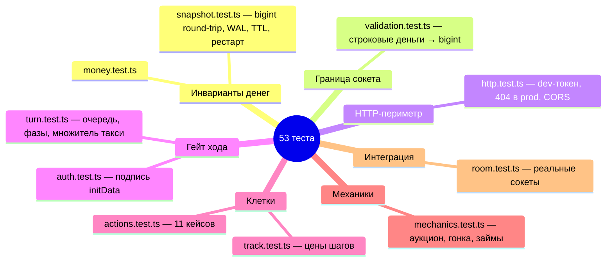

# TESTING — как устроены тесты

Запуск: `npm test` → `node --experimental-strip-types --test server/**/*.test.ts`
(`package.json:10`). На 2026-10-31 (после T1-core): **10 файлов, 53 теста, 0 fail**.

## Что покрывает каждый файл

| Файл | Суть покрытия |
|---|---|
| `money.test.ts` (2 теста) | `sub` отказывается уходить в минус; `euro` отказывается принимать дробь |
| `track.test.ts` (3) | ровно 9 уникальных клеток; шаги 1-2 бесплатны, 3-4 по 300 €; при завороте считаются пройденные шаги, а не «разность позиций» |
| `auth.test.ts` (2) | корректно подписанный initData возвращает id/имя; подмена user-поля ловится сверкой хеша |
| `turn.test.ts` (5) | прыжок 3 стоит 300 €; на клетке могут стоять все; чужой ход отклоняется `assertIntent`; движение добавляет шаги `rentSteps`; автоход таксует найденной не-retro машиной (ретро первой — множитель второй) |
| `actions.test.ts` (11) | ремонт списывает цену и ставит `ready`; beaten-ремонт = d6×множитель; неплатёжеспособный ремонт ничего не меняет; распил продаётся по цене покупки; кулдаун проката 8 → отказ, 9 → выплата и сброс; ретро не таксует и не сдаётся; просроченный долг блокирует покупку; perfect покупается сразу `ready` |
| `mechanics.test.ts` (9) | аукцион: старт с номинала, ставки, пасы, финал списывает лидера; гонка: пул с банковскими 1000 €, вход в пул, победа забирает весь пул; откуп 200 € и возврат ставки; займ: перевод, отсчёт, взыскание; picker покупает из любой не-retro колоды; чермет только для broken; ликвидационная победа; recycle колод; тайбрейк гонки |
| `snapshot.test.ts` (5) | Room c bigint-cash переживает round-trip через SQLite; файловая БД в WAL с busy_timeout 5000; TTL: 25-часовая комната удаляется, свежая остаётся; рестарт: комната восстанавливается в новом RoomManager; просроченный таймер при рестарте бьёт автоход |
| `validation.test.ts` (9) | `parseEuro` принимает bigint/число/строку и отклоняет `-50`/`abc`/`1.5`/`NaN`; `bid` со строкой → bigint, попадает в `[100n, 500n]`; `loan_offer` со строками нормализуется и проводит настоящий `grantLoan` с bigint-балансом; `race_invite` со строкой проходит настоящий `inviteRace`; `steps` строго 1..4; `turns` целое ≥ 1; id ≤ 64; неизвестные типы/мусор отклоняются |
| `http.test.ts` (5) | dev: `/dev/token` отдаёт подписанный initData; `/health` — 200 JSON; prod: `/dev/token` → 404, с `DEV_TOKEN=1` → 200; `/bundle.bad123.js` → 404, не index.html; traversal → 404; SPA-роут без расширения → index.html; CORS: белый список, dev-localhost, preflight 403 |
| `room.test.ts` (1) | интеграция на реальных socket.io-сервере и клиентах: три игрока в лобби, не-хост не стартует, старт даёт `room:state` с 1600 € и 1 машиной, автоход по таймауту (`missedLaps 1`), полный P2P-займ, taxi-ack возвращает `rolled` 1..6 |

## Как устроены фикстуры

Два стиля:

1. **Чистые фабрики** (большинство файлов): локальные `car()/player()/room()` собирают
   минимальный `Room` руками — см. `server/mechanics.test.ts:13-50`, `server/actions.test.ts:9-41`,
   `server/turn.test.ts:7-29`. Никакого общего test-helper-модуля нет — фабрики
   дублируются по файлам сознательно, чтобы каждый тест читался сам по себе.
2. **Подъём настоящего сервера** (`room.test.ts`): `createServer` + socket.io на порту 0,
   `openDb(':memory:')`, `RoomManager`, три socket.io-client; initData подписывается
   локально тем же алгоритмом, что `verifyInitData` (`server/room.test.ts:10-19`);
   teardown в `t.after` (`server/room.test.ts:40-47`). Важно: интенты шлются и напрямую
   через `manager.handleIntent(...)` с bigint-аргументами (`server/room.test.ts:126-132`) —
   это правил-уровневый тест; строковая граница JSON покрыта `server/validation.test.ts`.

Чтобы добавить тест: создайте `server/<тема>.test.ts` рядом с модулем, скопируйте
фабрики из соседнего тест-файла; `npm test` подхватит файл по маске `server/**/*.test.ts`.
`node:test` + `node:assert/strict` — никаких новых зависимостей.

## Чего нет (честный список пробелов)

- **Реконнект** — ни один тест не рвёт и восстанавливает сокет (`registerSocket`
  обработчик дисконнекта `server/room.ts:133-155` не покрыт).
- **Конкурентные интенты** — гонка двух одновременных `intent` на одном сокете не
  тестируется; защита де-факто — синхронность обработчиков, а не тест.
- **Property-тесты денег** — нет генеративных проверок `add/sub/canPay`; только 2
  точечных кейса.
- ~~**Граница JSON**~~ — закрыто в T1-core: `server/validation.test.ts` шлёт строковые
  `'100'`/`'200'`, как живой клиент (FINDINGS-1/2/3 решены).
- **HTTP-сокеты** — CORS/`allowRequest` самого socket.io тестируются только юнит-политикой
  `corsAllowsOrigin` (`server/http.test.ts:108-141`), реальный кросс-доменный сокет не поднимается.
- **Финансовая победа** — теста `checkWin` на 32 000 € нет (ликвидационная есть).
- **Таймеры** — `scheduleTurnTimer`/`handleTurnTimeout` покрыты только прямым вызовом
  `manager.handleTurnTimeout(roomId)` (`server/room.test.ts:113`), без ожидания реального времени.

## Недетерминизм — известное ограничение

`server/rng.ts:4` — `d6()` на `crypto.randomInt`, `shuffle` тоже на нём
(`server/rng.ts:6-17`). Замены в тестах нет: любая колода (`initGame`) и порядок ходов
(`rollTurnOrder`, `server/decks.ts:205-242`) перемешаны заново каждый прогон. Поэтому:

- тесты, которые зависят от конкретной карты/порядка, собирают `Room` фабриками, а не
  `initGame`;
- `room.test.ts` не проверяет порядок игроков, только их количество и капитал;
- воспроизводить падение «на том же кубике» невозможно — если баг плавающий, сначала
  зафиксируйте состояние комнаты (`getRoom`), затем стройте фабрику под него.

Гонки и аукционы в тестах детерминированы инъекцией `rollFn`/массива бросков
(`server/mechanics.test.ts:104-108, 282-295`) — `stepRaceRoll` принимает `rollFn`
параметром (`server/race.ts:152-155`), это единственная точка подмены случайности.
