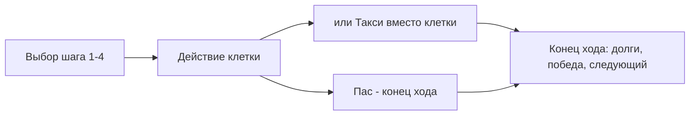

# 02 Как играть 🎲

Правила так, как их реализовал сервер (не как в RULES «хотелось» — расхождения честно помечены).

## Лобби 🚪

1. Хост кидает ссылку `t.me/<бот>?startapp=<id комнаты>` в чат.
2. Каждый вошедший видит стол на 4 слота. Минимум **3 игрока**, максимум 4.
3. Стартует только хост. Порядок ходов определяет сервер: все кидают d6, при ничьей — переброс между спорными (`server/decks.ts:205`).
4. Стартовый капитал — **1 600 €**, у каждого уже есть одно стартовое «Ведро» со своим дефектом (`server/decks.ts:245`).

## Ход 🔄

- **Шаг 1–2 бесплатно, 3–4 — по 300 € за каждый лишний шаг** (`server/track.ts:24`). Максимум +4 за ход. Двигаемся строго по часовой, трек — 9 клеток, толпиться можно сколько угодно.
- В свой ход можно и предложить **займ** другому игроку — кнопка «+ Займ» живёт рядом с выбором шага.

## Трек — 9 клеток 🛞

| Клетка | Что делаешь |
|---|---|
| 🪣 Вёдра | купить дешёвую машину (400–1 000 €) |
| 💥 Битьё | купить средний класс с кузовным дефектом (1 500–3 500 €) |
| 💎 Премиум | купить дорогую (5 000–10 000 €), чек на ремонт кусается |
| 🏛️ Ретро | автоматом открывается **аукцион** на ретро-машину |
| 🔍 Автоподбор | купить из любой колоды, кроме ретро, или выставить ретро на аукцион |
| 🔧 Автосервис | чинить машины (сколько влезет) или сдать хлам в чермет за 50 € |
| 💰 Скупка | продать готовую машину банку (распил — только по цене покупки) или в чермет |
| 🏢 Прокат | сдать все готовые: +500 € ведро/битьё, +1 000 € премиум. Повторно — через круг |
| 🏁 Гонка | вызвать соперника на дуэль с призовым банком |

## Деньги с машины 💶

- **Такси** — альтернатива действию любой клетки: бросок d6 × множитель класса (50/100/200 €). Можно таксовать даже битую, кроме ретро (`server/actions.ts:118`).
- **Ремонт** — фиксированная цена с карты дефекта; у «битья» цена = d6 × множитель, кубик кидает сервер.
- **Прокат-кулдаун**: сданная машина копит шаги твоих ходов; снова платит только после 9 шагов — топтаться на клетке проката бессмысленно (`server/actions.ts:100`).

## Аукцион 🔨

Ретро продаётся только с молотка: старт с номинала карты, шаг +100 или +500 €, таймер 10 с на решение, пас = выход. Останется один с деньгами — он забирает лот. Все спасовали — машина в сброс.

## Гонка 🏁

1. Вызвал соперника и поставил до 50 % его наличных.
2. Он либо принимает (ставка в пул, банк добавляет 1 000 €), либо **откупается за 200 €** — тебе.
3. Остальные за 10 с могут войти в пул с той же ставкой.
4. Все бросают чистый d6; максимум забирает весь пул, ничья — переброс.

## Кабала (P2P-займ) 💸

- «Даю X сейчас → верни Y через N **твоих** ходов». Согласился — деньги сразу, счётчик тикает в конце твоего хода.
- Нет денег к сроку: у тебя забирают всё, что есть, остаток долга растёт на **200 € за каждый ход просрочки**.
- Пока долг висит — покупать нельзя (`server/actions.ts:132`); полностью непогашенный долг не даёт и победить.

## Разорение ☠️

Три раза подряд не успел сделать ход за таймер (30 с + автоход за тебя) — сервер объявляет банкрот: машины сгорают в сброс, ты пропускаешь ходы. Остался один живой — он победил. Важно: в коде «пропущенный круг» считается как пропущенный ход, т.е. банкротство наступает быстрее, чем читается в RULES (это записано в списке расхождений).

> [!example] Один ход Пети
> У Пети 1 600 € и битая «Семёрка» (ремонт 300 €). Он жмёт «+2» — бесплатно, попадает на Автосервис, чинит машину за 300 €. Осталось 1 300 €. В следующем ходе едет «+3» за 300 € на Скупку и продаёт банку за 650 €. Итого за два хода: −600 € ходов, +650 € маржа, в гараже пусто — можно лезть в «битьё». Сервер на каждом шаге пересчитал всё сам: клиент только рисовал цифры.
