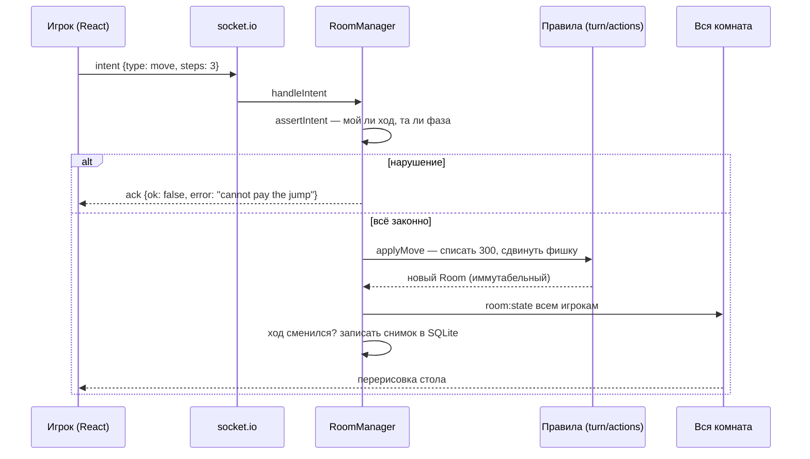

# 03 Один ход изнутри ⚙️

Что происходит между нажатием «Поехать +3» и новой цифрой на экране. Вся схема — факт из кода, пути в `code`-тексте.

## По шагам 🔍

1. **Кнопка** вызывает хелпер из `useGame` (`client/src/api/useGame.ts:145`) — клиент **ничего не считает**: ни денег, ни кубика, ни победы.
2. **Сокет** шлёт намерение и ждёт ack (`client/src/api/socket.ts:85`).
3. **Гейт.** `server/turn.ts:195` — `assertIntent` проверяет: не аукцион ли, не гонка ли, твой ли ход, можно ли такой интент в этой фазе.
4. **Правила.** `server/room.ts:175` маршрутизирует в модуль: ход — `server/turn.ts:16`, клетка — `server/actions.ts`, аукцион — `server/auction.ts`, гонка — `server/race.ts`, займ — `server/loans.ts`. Правила возвращают **новый** объект комнаты, старый не портят.
5. **Отказ.** Любое «нельзя» — это `RuleError` (`server/turn.ts:7`). Он превращается в `{ok:false, error:"…"}` в ack и параллельно в баннер на столе; соединение не рвётся. Русский словарь отказов — `client/src/api/present.ts:3`.
6. **Рассылка.** `updateRoom` (`server/room.ts:365`) подменяет комнату и шлёт `room:state` **всем** в комнате (`server/room.ts:473`) — у соперников стол меняется сам.
7. **Снимок.** Только если сменился номер хода — JSON комнаты пишется в SQLite (`server/room.ts:374`). Ставки аукциона и ремонты до конца хода в БД не попадают.
8. **Таймер.** На новый ход сервер ставит `setTimeout` на 30 с (`server/room.ts:390`); клиент показывает обратный отсчёт от `timerExpiresAt`, но решает таймер сервер.

> [!tip] Где именно сервер говорит «нельзя»
> Три уровня стен: (1) гейт фазы/очереди — `server/turn.ts:195`; (2) проверка клетки — `server/actions.ts:13`; (3) проверка денег — `sub` в `server/money.ts:22`, который физически не даёт балансу уйти в минус. Ни один из них не знает про UI — поэтому новые правила не ломают клиент.

> [!warning] Известная дыра на границе
> Клиент шлёт суммы **строками** (`"100"`), а правила ждут bigint. Для ставок и займов это уже ломает живую игру (см. [[07 Если что-то сломалось]]) — приведение типов на границе сокета пока не сделано.
