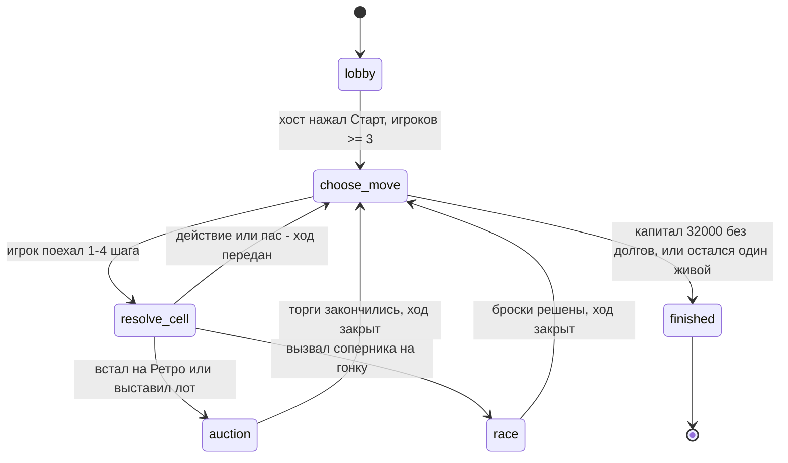

# 04 Состояния комнаты 🎭

Фаза живёт в `room.phase` и приходит каждому с каждым `room:state`. Диаграмма — то, что реально делает код (`server/types.ts:70` — список фаз, `server/turn.ts:58` — переходы).

## Что в каждой фазе 📋

| Фаза | Кто действует | Таймер | Что можно |
|---|---|---|---|
| `lobby` | все, старт — хост | нет | сидеть, ждать; старт при 3–4 |
| `choose_move` | только активный | 30 с | шаг +1…+4, предложить займ, пас |
| `resolve_cell` | только активный | те же 30 с | действие клетки, такси, пас |
| `auction` | торгающие по очереди | 10 с на шаг | ставка +100/+500, пас |
| `race` | по подстадии | 10 с / 10 с / 3 с | принять или откупиться → войти в пул → броски |
| `finished` | никто | таймер снят | экран победителя |

Подстадии гонки (`server/race.ts:36`): `invitation` (цель решает) → `pool_entry` (остальные в пул) → `rolling` (броски, при ничьей — переброс только лидеров). Аукцион и гонка — **вложенные** состояния внутри хода активного игрока, отдельной «партии» они не создают.

> [!info] Фаза `end_turn`
> В типах есть `end_turn` — сервер ставит её на мгновение, когда аукцион/гонка разрешились, и тут же передаёт ход. Клиент её не видит, экрана «конец хода» нет.

## Что видит игрок, если отвалился 📴

- **Соединение рвётся в лобби** — тебя просто вычеркивают из слотов, лобби всем обновилось (`server/room.ts:112`).
- **Соединение рвётся в игре** — сервер ждёт 10 секунд (`server/room.ts:454`). Если это твой ход — таймер ужимается до 5 с (`server/turn.ts:49`), дальше сервер делает **автоход за тебя**: минимальный шаг и такси (`server/turn.ts:150`). Каждый автоход отмечается; три подряд — банкрот, машины сгорают в сброс (`server/turn.ts:78`).
- **Вернулся** — открыл ту же ссылку, телефон снова шлёт `auth`, сервер мгновенно отдаёт актуальный стол (`server/room.ts:59`). Клиент сам пере-логинится при восстановлении связи (`client/src/api/useGame.ts:38`).
- **Рестарт самого сервера** — другой случай: партия теряется, лобби собирается заново. Восстановление из БД заявлено в RULES, но не подключено (см. [[07 Если что-то сломалось]]).

> [!tip] Кому смотреть на часы
> Сервер присылает `timerExpiresAt` — момент, когда истечёт таймер. Клиент считает секунды от собственного времени, подстраиваясь по `updatedAt` (`client/src/components/auction/AuctionModal.tsx:17`) — это только циферки. Реальное решение о таймауте принимает `setTimeout` на сервере.
