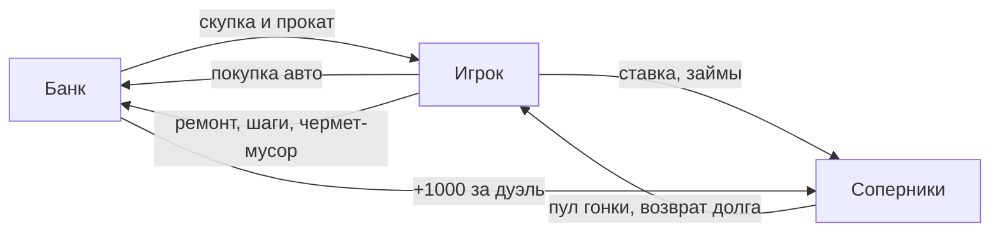

# 05 Экономика 💶

Откуда берутся все числа и где их крутить. Таблицы — факт из кода; путь файла в `code`-тексте. **Баланс не отлажен** — это стартовые числа, а не выверенный дизайн.

## Деньги входят 💰

| Параметр | Значение | Где в коде |
|---|---|---|
| Стартовый капитал | 1 600 € | `server/money.ts:9`, `server/decks.ts:5` |
| Такси: доход за ход кубика | d6 × 50 / 100 / 200 € (ведро/битьё/премиум) | `server/money.ts:14`, формула `server/actions.ts:118` |
| Прокат: разовая выплата | +500 € ведро и битьё, +1 000 € премиум, ретро не сдаётся | `server/money.ts:15` |
| Скупка банком | цена `buyout` с карты машины | `server/decks.ts:7` и далее |
| Чермет | +50 € за сломанную машину | `server/actions.ts:59` |
| Гонка: призовой банк | ставка + ставка цели + 1 000 € банка + входы пула | `server/race.ts:5,67` |

## Деньги выходят 💸

| Параметр | Значение | Где в коде |
|---|---|---|
| Шаг 3–4 | 300 € за каждый шаг сверх двух | `server/track.ts:24` |
| Покупка | 400–1 000 € ведро, 1 500–3 500 € битьё, 5 000–10 000 € премиум, 8 000–15 000 € ретро | каталоги `server/decks.ts:7-52` |
| Ремонт (фикс) | 200–600 € ведро, 1 500–4 500 € премиум, 3 000–5 000 € ретро | `server/decks.ts:54-94` |
| Ремонт битья | d6 × 100…400 € | `server/decks.ts:66-75`, бросок в `server/room.ts:212` |
| Распил | продаётся строго по цене покупки — маржа 0 | `server/actions.ts:57` |
| Откуп от гонки | 200 € инициатору | `server/race.ts:6` |
| Просрочка займа | +200 € к долгу за каждый ход | `server/loans.ts:5` |
| Ставка гонки | не больше 50 % наличных цели | `server/race.ts:33` |

## Как деньги идут по кругу 🔄

## Победа 🏆

`cash ≥ 32 000` **и** долгов нет — проверяется в конце своего хода (`server/turn.ts:54`). Альтернатива — остаться единственным небанкротом (`server/turn.ts:59`).

## Что крутить для баланса 🔧

> [!warning] Честное предупреждение
> Числа взяты «с руки», ни одного прогона баланса не делали. Все деньги — в двух файлах: `server/decks.ts` (цены машин, выкупы, дефекты — страницы 7–94) и `server/money.ts` (константы экономики, 26 строк). Крутишь там — тесты `npm test` скажут, если сломал инварианты (например, «минус не даём»).

- **Хочешь быстрее партия** — подними такси-множители и прокат в `server/money.ts:14-15`.
- **Хочешь острее середину** — у премиума покупка близко к выкупу? Маржа задана парами `purchase/buyout` в каталогах `server/decks.ts`.
- **Хочешь злее кредит** — `LOAN_LATE_FEE` в `server/money.ts:18` и логика взыскания `server/loans.ts:68`.
- **Налогов в игре нет**: слово «налог» в коде не встречается — из «обязательных» списаний только шаги свыше двух. Если захочется — место для них в `advanceTurn` (`server/turn.ts:58`).

> [!example] Проверить маржу класса за минуту
> Ведро: покупка 400–1 000, выкуп 650–1 350, ремонт 200–600 → чистая маржа примерно −150…+550 € плюс таксист. Премиум: покупка 5 000–10 000, выкуп 7 600–14 500, ремонт до 4 500 → выше и риск, и награда. Ретро вообще без скупки-гарантии: сначала аукцион, потом либо реставрация до 5 000 €, либо музейное состояние — джекпот.
